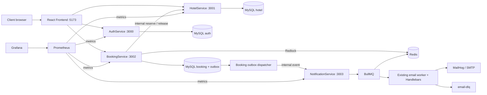

# Restivio

An educational hotel-booking application demonstrating reliable workflows and common distributed-system patterns. Built incrementally on the original HotelService, BookingService and NotificationService; AuthService completes identity and access control. A React + TypeScript frontend makes the existing APIs usable for guests, hotel managers and administrators. There is no payment integration.

The root-level [Frontend/](Frontend/README.md) uses Vite, React Router, Axios, Context and plain CSS. See its README for frontend development, session handling, role-aware pages and the booking demo.

## Architecture



Each service owns its MySQL schema. There are no cross-schema foreign keys or per-request calls to AuthService. Service database accounts are restricted to their own schemas. The local stack uses one MySQL instance and one persistent Redis instance.

The existing repository/service/controller layers, hotel soft deletion, category validation, dated physical-room inventory, row-locking reservation algorithm, API versioning, Winston logging, AsyncLocalStorage, BullMQ worker, Nodemailer and booking email templates are retained. Changes extend those components, rather than creating competing implementations.

## Start locally

Requires Docker Desktop with its Linux engine running and Docker Compose v2. Node.js 22 is needed only for host-side development and tests.

PowerShell:

```powershell
Copy-Item .env.example .env
docker compose up -d --build --wait --wait-timeout 240
docker compose ps
```

macOS/Linux:

```sh
cp .env.example .env
docker compose up -d --build --wait --wait-timeout 240
```

Copy the example only when creating your local configuration. The first build downloads images and npm dependencies. Startup creates databases, runs the existing migrations followed by new migrations, seeds local accounts, and generates 90 days of demo inventory. Later starts reuse named volumes and do not reset passwords or bookings. Demo inventory generation safely adds missing dates.

The root `.env` configures Compose. Existing per-service `.env` files are not copied into images. Example credentials are deliberately local demo values; no real credentials belong in Git. Keep `SEED_DEMO=true` for this local walkthrough. Set it to false if demo accounts are not desired.

MailHog's inbox is in memory and clears when its container restarts. The local Redis
instance demonstrates distributed coordination across processes; it is not a highly
available Redis quorum.

| Component | Local URL |
| --- | --- |
| React frontend | http://localhost:5173 |
| AuthService / Swagger | http://localhost:3000/docs |
| HotelService / Swagger | http://localhost:3001/docs |
| BookingService / Swagger | http://localhost:3002/docs |
| NotificationService internal API docs | http://localhost:3003/docs |
| MailHog inbox | http://localhost:8025 |
| Prometheus | http://localhost:9090 |
| Grafana dashboard | http://localhost:3004/d/restivio-overview |

Every service exposes `/health/live`, `/health/ready`, `/metrics`, and `/openapi.json`. All published ports bind to loopback. MySQL is available at `127.0.0.1:3307`, Redis at `127.0.0.1:6380`, and SMTP at `127.0.0.1:1025`.

### Local demo accounts

| Email | Role | Password |
| --- | --- | --- |
| admin@restivio.local | ADMIN | RestivioDemo123! |
| manager@restivio.local | HOTEL_MANAGER | RestivioDemo123! |
| user@restivio.local | USER | RestivioDemo123! |

The demo manager owns the **Restivio Demo Hotel**. Its DOUBLE category has three physical rooms priced at 2500 per room/night. Prices use INR units for the demo; no currency conversion or payment processing is implemented.

Grafana login is `admin` / `restivio-local-grafana` with the example environment. The Prometheus data source and Restivio dashboard are provisioned automatically.

## API walkthrough

Use PowerShell's `Invoke-RestMethod`, Swagger, Postman, or `curl.exe`. These examples derive dates dynamically and locate the seeded hotel rather than assuming IDs.

```powershell
$login = Invoke-RestMethod http://localhost:3000/api/v1/auth/login -Method Post -ContentType 'application/json' -Body '{"email":"user@restivio.local","password":"RestivioDemo123!"}'
$headers = @{ Authorization = "Bearer $($login.data.accessToken)"; 'Idempotency-Key' = [guid]::NewGuid().ToString(); 'X-Correlation-ID' = 'demo-booking' }
$hotels = Invoke-RestMethod http://localhost:3001/api/v1/hotels
$hotel = $hotels.data | Where-Object name -eq 'Restivio Demo Hotel'
$categories = Invoke-RestMethod "http://localhost:3001/api/v1/hotels/$($hotel.id)/room-categories"
$category = $categories.data | Where-Object roomType -eq 'DOUBLE'
$checkIn = (Get-Date).AddDays(7).ToString('yyyy-MM-dd')
$checkOut = (Get-Date).AddDays(9).ToString('yyyy-MM-dd')
Invoke-RestMethod "http://localhost:3001/api/v1/hotels/$($hotel.id)/availability?checkIn=$checkIn&checkOut=$checkOut&rooms=1"
$intent = @{ hotelId=$hotel.id; roomCategoryId=$category.id; checkIn=$checkIn; checkOut=$checkOut; numberOfRooms=1; totalGuests=2 } | ConvertTo-Json
$booking = Invoke-RestMethod http://localhost:3002/api/v1/bookings -Method Post -Headers $headers -ContentType 'application/json' -Body $intent
# Same key and body returns the original booking and does not reserve again.
Invoke-RestMethod http://localhost:3002/api/v1/bookings -Method Post -Headers $headers -ContentType 'application/json' -Body $intent
Invoke-RestMethod "http://localhost:3002/api/v1/bookings/$($booking.data.id)/cancel" -Method Post -Headers $headers
```

Inspect both emails in MailHog. If the demo dates are full, cancel existing bookings or select another generated date range.

### Main endpoints

| Service | Method and path | Access |
| --- | --- | --- |
| Auth | POST /api/v1/auth/register | Public; always USER; role input rejected |
| Auth | POST /api/v1/auth/login | Public; bcrypt verification |
| Auth | POST /api/v1/auth/refresh | HTTP-only refresh cookie |
| Auth | POST /api/v1/auth/logout | Revokes refresh cookie |
| Auth | GET /api/v1/auth/me | Bearer JWT |
| Hotel | GET /api/v1/hotels and /:id | Public |
| Hotel | POST /api/v1/hotels | HOTEL_MANAGER / ADMIN |
| Hotel | PUT or DELETE /api/v1/hotels/:id | Owner manager / ADMIN |
| Hotel | GET /api/v1/hotels/:hotelId/room-categories | Public |
| Hotel | POST /api/v1/hotels/:hotelId/room-categories | Owner manager / ADMIN |
| Hotel | PATCH or DELETE /api/v1/hotels/:hotelId/room-categories/:roomCategoryId | Owner manager / ADMIN |
| Hotel | POST /api/v1/hotels/:hotelId/room-categories/:roomCategoryId/inventory/generate | Owner manager / ADMIN |
| Hotel | GET /api/v1/hotels/:hotelId/availability | Public |
| Booking | POST /api/v1/bookings | Authenticated; Idempotency-Key required |
| Booking | GET /api/v1/bookings?offset=0 | Own bookings; ADMIN sees all; pages of 50 |
| Booking | GET /api/v1/bookings/:id | Owner / ADMIN |
| Booking | POST /api/v1/bookings/:id/cancel | Owner / ADMIN |

Internal endpoints require `X-Internal-Service-Key`: HotelService `POST /api/v1/internal/rooms/reserve` and `/release`; NotificationService `POST /api/v1/internal/events`. The legacy `/api/v1/notification/email` endpoint is retained but now internal-only and restricts template names. External booking confirmation is automatic; the old separate confirm endpoint and old cancellation path have intentionally been replaced.

## How the workflows work

### Authentication and roles

Access JWTs last 15 minutes, use HS256, and include userId, email and role with fixed issuer/audience checks. HotelService and BookingService verify them locally using `JWT_SECRET`. Public registration rejects role assignment.

Refresh tokens are random opaque values, stored only as SHA-256 hashes in MySQL, expire after seven days, and rotate under a row lock. Logout revokes the current refresh token. Cookies are HTTP-only, SameSite=Strict and non-Secure for local HTTP; configure `COOKIE_SECURE=true` with HTTPS. Set `AUTH_ORIGIN` if the local auth browser origin changes. Access tokens remain valid until their short expiry, including after logout or a role change.

USER can book, view and cancel their own bookings. HOTEL_MANAGER has those actions plus management of their own hotels/categories/inventory. ADMIN can manage all hotels and inspect/cancel any booking. Ownership comes from JWT at hotel creation and cannot be supplied or reassigned through a client update.

### Reservation and concurrency

1. Validate booking intent and client `Idempotency-Key`.
2. Create a durable PENDING booking plus an idempotency record atomically. A unique database key elects the original request.
3. Acquire a Redlock lease scoped to hotel/category/check-in/check-out.
4. Lock the idempotency and booking records and call HotelService with the internal secret and correlation ID.
5. HotelService uses its existing MySQL transaction, `SELECT ... FOR UPDATE`, whole-stay physical-room selection and conditional inventory updates. It verifies the exact number of rows assigned. Checkout is exclusive.
6. HotelService returns room numbers, nights, price and total. BookingService uses that trusted price, writes CONFIRMED plus the outbox event and saved idempotent response in one transaction.

The physical inventory uniqueness constraint is `(hotel_id, room_no, date_of_availability)`. There is no mutable available-room counter. Redlock reduces contention; overlapping date ranges can use different Redis keys and leases can expire. MySQL row locks, transactions and constraints are the final protection. A separate internal concurrency test bypasses Redis to demonstrate this.

A small HotelService reservation ledger serializes reserve/release by booking ID, snapshots the original price and retains release tombstones. A delayed reservation cannot resurrect inventory after release.

### Idempotency

The client supplies a printable opaque key, up to 128 characters. The existing unique `idemKey` column stores SHA-256 of the user ID and client key; the request fingerprint hashes validated, ordered intent fields. No key is generated on the client's behalf.

Same user/key/intent returns the original status and response, including after cancellation; `Idempotency-Replayed: true` identifies replay. Different intent returns 409. Different users may use the same raw key. A completed failed attempt is also retained; use a new key when starting a genuinely new attempt. Records are retained for this demo rather than silently expiring replay protection.

### Cross-service failures and cancellation

There is no distributed database transaction. PENDING commits before the remote reservation, so interrupted work remains discoverable. If reservation or final persistence fails, BookingService marks the request COMPENSATING, then attempts idempotent release and records a cancelled attempt. If release fails, the request remains recoverable. A background loop compensates PENDING bookings older than one minute. Retrying the same key also resumes compensation.

HotelService release creates a durable tombstone even if reserve has not arrived yet, covering ambiguous HTTP timeouts. Recovery checks the locked idempotency result before releasing, so a completed confirmed booking is not compensated.

Cancellation locks the booking, checks ownership/state, releases rooms, then commits CANCELLED plus a cancellation outbox event. Repeated cancellation returns the cancelled booking without another event. If cancellation persistence fails after release, the booking can temporarily read CONFIRMED although rooms have been released; retry cancellation to finish. This is an explicit cross-service consistency trade-off, not an atomic cross-database claim.

Historical bookings have nullable stay fields because the old records never contained that information. They remain readable; the API cannot invent their historical room allocation. Existing hotels with no owner are manageable by ADMIN. Migrations never fabricate ownership or overwrite old records.

### Outbox, retries and email

The dispatcher polls each second, processes bounded batches, and uses row locks with skip-locked for multiple dispatcher safety. It marks an event PUBLISHED only after NotificationService accepts it into BullMQ. Failures retain the event, error and attempt count with capped exponential delivery delays.

NotificationService maps the two event types to the existing Handlebars templates. Event UUIDs are deterministic BullMQ job IDs. Completed/failed jobs are retained so replaying an accepted outbox event does not enqueue a second logical email. SMTP failures retry three times with exponential backoff and jitter. Exhausted jobs remain in the failed set and are copied to `email-dlq` with event ID, booking ID, attempt count and failure reason.

This guarantees durable retry and logical queue deduplication within the retained Redis data, not exactly-once SMTP delivery: a worker crash after SMTP acceptance but before BullMQ completion can deliver another email. Redis AOF is enabled with every-second fsync. There is no automatic retention cleanup; removing completed jobs or Redis data removes their deduplication history. The retained failed source job remains available if copying to the DLQ itself fails.

## Development, migrations and tests

```powershell
npm ci
npm run install:services
npm run typecheck
npm run build
npm test
# Requires the healthy Compose stack above:
npm run test:integration
# Additionally exercise controlled notification/SMTP outages and compensation:
$env:TEST_CHAOS = 'true'
npm run test:integration
Remove-Item Env:TEST_CHAOS
```

On macOS/Linux use `TEST_CHAOS=true npm run test:integration`. Integration tests use Jest + Supertest against real HTTP services, MySQL and Redis. They create uniquely named fixtures in the isolated local stack; they never truncate your databases. Chaos tests briefly stop/start only this Compose project's NotificationService/MailHog and install a temporary, fixture-specific SQL trigger to test persistence failure. Use a dedicated local test stack while running them.

Unit tests cover JWT signature/issuer/audience/expiry/claim validation, role checks, internal credentials, canonical fingerprints, trusted intent, dates and event mapping. Integration tests cover auth/refresh/logout, RBAC, ownership, inventory generation/search, booking/cancellation, concurrent duplicate keys, limited-capacity requests, database protection without Redis, outbox delivery, deduplication, MailHog, health, Prometheus and provisioned Grafana. See [verification notes](docs/verification.md) for results actually observed.

Migration commands:

```sh
docker compose exec auth npm run migrate
docker compose exec hotel npm run migrate
docker compose exec booking npm run migrate
docker compose exec auth npm run seed
docker compose exec hotel node dist/db/seed.js
```

The small migration runner supports the repository's mixed TypeScript default/CommonJS exports and keeps original filenames in `SequelizeMeta`. Application schemas use migrations; only the migration ledger is initialized with `sync()`, never `sync({alter:true})`.

New migrations:

- Auth `20261005000100-create-auth-tables.ts`: users and hashed refresh tokens.
- Hotel `20261005000200-add-hotel-ownership-and-reservation-ledger.ts`: manager ID, inventory lookup indexes and reservation/release ledger.
- Booking `20261005000300-evolve-bookings-idempotency-outbox.ts`: reservation details, decimal amount, idempotency request/result fields and outbox.

Original migrations and the original historical hotel seeder remain intact. Compose uses the new idempotent demo seed instead of the old fixed-date seed. To run a service directly, set its DB variables, JWT/internal secret, and dependency URLs to the exposed host ports, then run its `npm run migrate`, `npm run build` and `npm start`.

CI installs dependencies, typechecks, builds, runs unit tests, starts Compose and runs integration/chaos tests. It has no deployment steps. A workflow file being present does not mean a remote CI run has occurred.

## Observability and operations

`X-Correlation-ID` flows through BookingService, HotelService, outbox, NotificationService and job logs. If absent, a UUID is generated and returned in the response. Winston emits JSON with service and correlation context. Credentials/tokens/passwords are not logged.

Prometheus scrapes all four services every five seconds. Metrics include request count/status/duration/errors, booking outcomes, idempotency replays, inventory outcomes/releases, outbox state/delivery attempts, and email outcomes/queue/DLQ counts. HTTP route templates are used as labels, never raw IDs. The single Grafana dashboard shows traffic, errors, p95 latency, booking conflicts, outbox state, queue outcomes and DLQ.

```sh
docker compose logs -f booking hotel notification
docker compose ps
docker compose stop
docker compose start
docker compose down
```

`down` preserves named volumes. Do not add `--volumes` unless intentionally discarding local demo data. SMTP credentials remain configurable with `SMTP_HOST`, `SMTP_PORT`, `SMTP_USER`, `SMTP_PASS`, `SMTP_SECURE` and `MAIL_FROM`.

This is an explainable local backend exercise. It deliberately omits payments, OAuth, an API gateway, Kafka, Kubernetes, cloud deployment and OpenTelemetry.
